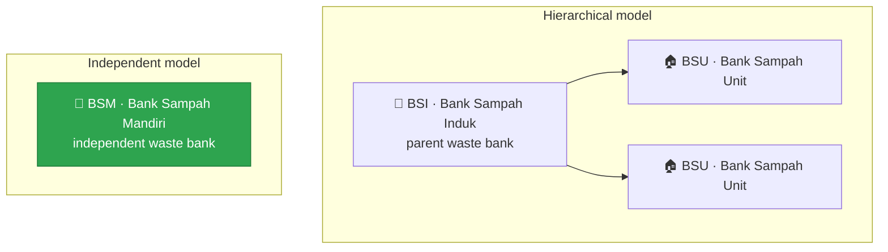
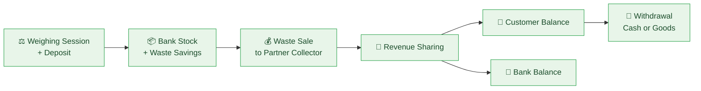

<div align="center">

# ♻️ Digital Waste Bank Admin Dashboard (BSI, BSU, BSM)

**Turning household waste into savings — and giving every waste bank admin one place to run it.**


</div>

---

## 🌍 About

This web app is the **admin dashboard** of a digital waste bank platform. Each waste bank's admin uses it to set up how the bank runs and to keep track of everything that happens in it.

Day-to-day transactions (weighing customers' waste, selling it to partner collectors, sharing the revenue, and serving withdrawals) are carried out by officers (**petugas**) and customers (**nasabah**) in the mobile app. The dashboard covers the **supporting side**: catalogs, schedules, revenue-sharing percentages, customers, partner collectors, and staff, plus balances, transaction history, and reports.

The platform supports a **multi-level waste bank hierarchy**:



> [!NOTE]
> This README focuses on the **BSM (Bank Sampah Mandiri)** admin dashboard, the first level to reach its final state.

---

## 🚦 Project Status

| Level | Description | Status |
| :---: | --- | :---: |
| **BSM** | Bank Sampah Mandiri: independent waste bank | ✅ **Final** |
| **BSI** | Bank Sampah Induk: parent waste bank | 🚧 In development |
| **BSU** | Bank Sampah Unit: unit waste bank under a BSI | 🚧 In development |

---

## 🔄 Core Business Processes

Four processes form one continuous cycle, from the moment waste is weighed to the moment the customer collects their reward. They run in the mobile app, not in this dashboard. The dashboard prepares what they depend on (catalogs, schedules, partner collectors, and sharing percentages) and lets admins follow every result through the **Transaction History**, detail pages, and Excel reports.



---

## 🧰 Supporting Features

<table>
  <tr>
    <td width="50%" valign="top">
      <h3>🗂️ Waste & Goods Catalog Management</h3>
      Each bank manages its own <b>waste catalog</b> (category, incentive type, and sorting requirements per item, with prices updated automatically from sales) and <b>goods catalog</b> (point price and stock, with top-ups and stock corrections). Catalogs can be filtered, every waste item shows its <b>price change history</b>, and both catalogs export to Excel.
    </td>
    <td width="50%" valign="top">
      <h3>📅 Schedule Management</h3>
      A monthly <b>calendar</b> of weighing sessions, built from <b>recurring schedules</b> (a day of the week on the n-th week of the month) and <b>special one-off schedules</b> with their own date and name. Recurring schedules can be added in batches across several days and weeks, or for every week at once.
    </td>
  </tr>
  <tr>
    <td width="50%" valign="top">
      <h3>📊 Customizable Revenue-Sharing Percentage</h3>
      Each bank sets its own <b>customer share percentage</b> per incentive type (Cash / Goods) and can review its full <b>change history</b>. Deactivating an incentive type stops the bank from accepting new deposits of the waste tied to it.
    </td>
    <td width="50%" valign="top">
      <h3>💳 Bank Mutation & Customer Balance Monitoring</h3>
      The bank's <b>cash and point balance</b> with a complete <b>mutation log</b> (credit vs. debit summary), including manual credit/debit entries, alongside a <b>customer balance monitor</b> showing the total across all customers and a per-customer list.
    </td>
  </tr>
  <tr>
    <td width="50%" valign="top">
      <h3>📈 Dashboard</h3>
      Monthly <b>waste deposit statistics</b> grouped by category, incentive type, or unit, a <b>waste sales trend</b> split into cash and goods value, and the <b>top contributing customers</b> ranked by number of deposits, kg, pcs, or liters.
    </td>
    <td width="50%" valign="top">
      <h3>🧾 Reporting & Archiving</h3>
      A <b>Transaction History</b> of weighing sessions, withdrawals, sales, and revenue sharing, with search, date-range filters, and a detail page for every record. Downloadable <b>Excel reports</b> per transaction (weighing, sale, revenue sharing) and as <b>period recaps</b>, plus exports of the customer list and both catalogs.
    </td>
  </tr>
</table>

---

## 🗃️ Other Admin Features

<table>
  <tr>
    <td width="50%" valign="top">
      <h3>👥 Customer Management</h3>
      Register customers from <b>new data</b> or from an <b>existing account</b>, track active and inactive counts, and open each customer's profile with their <b>deposit, revenue-sharing, and withdrawal history</b>. Accounts can be deactivated, reactivated with generated activation details for the customer, or removed.
    </td>
    <td width="50%" valign="top">
      <h3>🤝 Partner Collector Management</h3>
      Keep the list of <b>partner collectors</b> (<i>mitra pengepul</i>) that the bank sells its waste to: add, edit, or remove them, and filter them by active status.
    </td>
  </tr>
  <tr>
    <td width="50%" valign="top">
      <h3>🧑‍💼 Staff Management</h3>
      Manage the bank's <b>admins and officers</b> (<i>petugas</i>): add staff from existing user accounts with a chosen role, open their profiles, and deactivate, reactivate, or remove them. The bank's profile can be edited too, and every change to it is kept in an <b>account log</b>.
    </td>
    <td width="50%" valign="top">
      <h3>🔔 Notifications</h3>
      An in-app <b>notification center</b> with an unread filter. Opening a notification marks it as read, and everything can be marked as read at once.
    </td>
  </tr>
</table>

---

## 🛠️ Tech Stack

| Area | Tools |
| --- | --- |
| UI & routing | React 19, React Router 7, React Icons |
| Language & build | TypeScript 5.9, Vite 7 |
| API client | Axios |
| Maps | Leaflet, React Leaflet |
| Code quality | ESLint 9 with typescript-eslint and React Hooks rules |
| Deployment | Docker (multi-stage build), Nginx |

---

## 🚀 Getting Started

### Prerequisites

- **Node.js** `^20.19` or `>=22.12` (required by Vite 7)
- A running instance of the waste bank **backend API**

### Run locally

```bash
npm install
```

Create a `.env` file in the project root that points to the API:

```env
VITE_API_URL=<backend API base URL>
```

```bash
npm run dev     # dev server at http://localhost:5173
npm run build   # type-check, then build for production into dist/
```

### Run with Docker

```bash
docker compose up -d --build
```

The app is built in a Node container and served by **Nginx** at `http://localhost:3000`. `VITE_API_URL` is passed as a build argument in `docker-compose.yml`, and because Vite embeds it at build time, changing the API URL requires a rebuild.

---

<div align="center">
  <sub>♻️ Every kilogram counts. Built for a cleaner, more rewarding way to manage waste. 🌱</sub>
</div>
